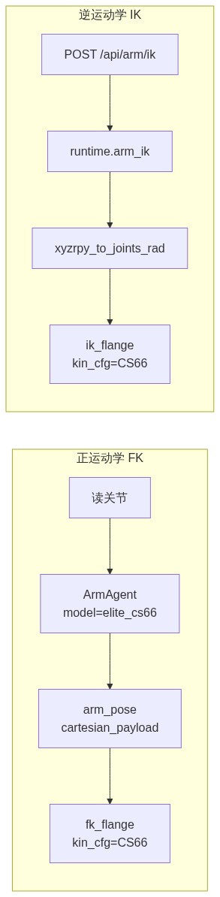
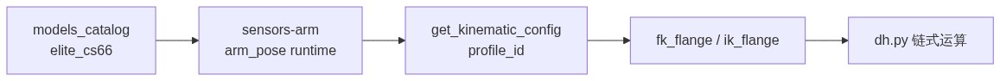

# CS66 正逆运动学（路线 A）备忘

从「选择 A：并进现有 `sensors.kinematics`」之后的讨论整理。  
目标：给 CS66 单独一套 DH/零点/TCP，挂到现有 FK/IK API；**不**用 Elite CS SDK 的 KDL 插件。

---

## 1. 路线 A 在改什么

把现在「全局一份 EC616 DH」改成「按型号选 `KinematicConfig`」，CS66 单独一套参数。

调用链（改完后）：

<p align="center">
  
</p>
<p align="center"><em>图：改完后 FK 与 IK 分别按型号注入 kin_cfg（示意）。</em></p>

---

## 2. 要改的代码位置

### 2.1 hik-sensors：`sensors/src/sensors/kinematics/`（必改，且可锁在此包）

| 位置 | 现状 | 要做什么 |
|------|------|----------|
| `constants.py` | 只有 EC616 的 `LINK_LENGTH_MM` / `JOINT_OFFSET_DEG` / `TEACH_PENDANT_POSES` | **新增 CS66 常量块**（连杆、零点、方向、软限位、校验点）；EC616 保留作默认。可改成从 `profiles.elite_ec616` re-export，避免破坏旧 import |
| `config.py` | `build_kinematic_config()` / `get_kinematic_config()` 单例 | 改成 **`build_kinematic_config(profile_id)` / `get_kinematic_config(profile_id)`**，按型号缓存 |
| `dh.py` | `dh_table_from_link_lengths_m` 假定「偏置腕 + 标准 DH」 | 用 CS66 的 `d1…d6`（或 MDH→标准 DH）填表；构型不一致再扩展 |
| `__init__.py` | `make_hik_fk_fn()` 无型号参数 | 改为 **`make_hik_fk_fn(profile_id=...)`**，内部把 `kin_cfg` 传给 `fk_flange` |
| `fk.py` | 已支持 `kin_cfg=` | 基本不动；默认仍回落 EC616 |
| `ik.py` | 已支持 `kin_cfg=` | 同上；CS66 的 soft limits 走新 config |
| `teach.py` | EC616 示教软限位 | **按型号**取限位（无参 = 仍 EC616，兼容 `cs_write` / `elite_write`） |
| 建议新建 `profiles/` | 无 | 把 CS66 参数从 EC616 文件里拆开，见第 3 节 |

测试（建议）：`sensors/tests/test_kinematics_cs66.py` — 示教/RTSI 对照点验 FK；FK→IK→FK 闭环。  
可选脚本：从 Primary 拉 `KinematicsInfo` 打印 MDH。

### 2.2 sensors-arm：按臂选用（必改，但不在 hik-sensors 里）

| 位置 | 现状 | 要做什么 |
|------|------|----------|
| `src/sensors_arm/arm_pose.py` | 全局一个 `_fk_fn`；`ik_flange` 不传型号 | FK/IK **带 `profile_id` / `kin_cfg`**；`cartesian_payload(..., profile_id=)` |
| `src/sensors_arm/runtime.py` | `warm_kinematics()` 无型号；`arm_ik` 只传 `tcp_xyz` | 按已配置型号预热；`arm_ik` 传入该臂 model（如 `elite_cs66`） |
| `src/sensors_arm/agents/arm_agent.py` | `cartesian_payload(joints)` | 传入本臂 model / tcp |
| `src/sensors_arm/agents/arm_write_agent.py` | 同上 | 同上 |
| `src/sensors_arm/viz.py` | `POST /api/arm/ik` | 一般不用改接口；runtime 按 `arm_id` 解析型号即可 |
| `src/sensors_arm/config.py` + `configs/models_catalog.yaml` | CS66 注明 FK 不可信 | 增加 `kinematics_profile: elite_cs66`、默认 `tcp_xyz`；改 notes |
| `docs/cs66.md` / `docs/ec66.md` | 写明勿当真 | 更新为「CS66 已挂独立 profile」及验收方式 |

### 2.3 不必改（路线 A）

- Elite KDL 插件、`arm_cs_write` 驱动本身、URDF 网格（仍只做可视化）
- hik-sensors 里 **kinematics 以外** 的包（驱动、export 等）——只要 kinematics 做加法、默认仍 EC616

---

## 3. `sensors/kinematics` 多型号怎么组织

原则：**求解器一份，型号数据多份。** 不要给每种臂复制 `fk.py` / `ik.py`。

卡住多臂的是 `constants.py` + `get_kinematic_config()` 全局单例，以及 `teach.py` 把软限位/校验点写死成 EC616。`fk_flange` / `ik_flange` 已经能吃 `kin_cfg`。

### 3.1 目标目录

```text
sensors/src/sensors/kinematics/
  __init__.py          # 对外 API：get_profile / make_hik_fk_fn(profile_id)
  model.py             # 数据结构（扩展，不拆算法）
  dh.py                # 标准 DH 运算 + 可选 MDH→标准 DH
  fk.py                # 不变：只吃 KinematicConfig
  ik.py                # 不变：只吃 KinematicConfig；限位从 cfg 来
  config.py            # 注册表 + 按 profile_id 缓存
  teach.py             # 限位/校验点从 profile 取；无参仍 EC616
  robot_xml.py         # 仍可作为「从 XML 造 profile」的工厂
  rmp.py               # 构造时传入 profile_id
  profiles/
    __init__.py        # PROFILE_REGISTRY
    _common.py         # 共享：轴向枚举、PI2、build_T_base
    elite_ec616.py     # 现 constants.py 整包搬过来（默认）
    elite_cs66.py      # 连杆/零点/方向/限位/校验点
```

`constants.py` 做成薄兼容层：`from .profiles.elite_ec616 import *`，旧 `from sensors.kinematics.constants import LINK_LENGTH_MM` 不炸。

### 3.2 型号数据：`ArmKinematicsProfile`（加在 `model.py`）

每个 `profiles/*.py` 只放数：

| 字段 | 含义 |
|------|------|
| `id` | 与 catalog 对齐：`elite_ec616` / `elite_cs66` |
| `dh_convention` | `"standard"` 或 `"modified"` |
| `dh_table` 或 `link_len_m` / MDH 三矢量 | 几何 |
| `joint_offset_deg` / `joint_dir` | 角约定 |
| `joint_angle_mode` | CS 读数先 rad→deg 仍可走现路径 |
| `T_base` | 安装/基座 |
| `soft_min_deg` / `soft_max_deg` | IK 边界 |
| `teach_poses` | 校验点（可空，材料齐了再填） |
| `default_tcp_xyz` | 法兰→TCP 平移；TCP 叠加仍在 `arm_pose`，不进 DH |

`config.build_kinematic_config(profile_id)`：profile → 现有 `KinematicConfig`（必要时 MDH 转标准 DH）。

`KinematicConfig` 建议补：`soft_min_deg` / `soft_max_deg`、`profile_id`（调试），避免 `ik.py` 再调全局 `teach_joint_soft_limits_deg()`。

### 3.3 注册与查找

```text
get_profile(profile_id) -> ArmKinematicsProfile
get_kinematic_config(profile_id=None) -> KinematicConfig
```

- `profile_id=None` → **`elite_ec616`**（hik_dataset / 不传型号的调用保持原行为）
- 缓存改为 `dict[str, KinematicConfig]`，不要一个全局 `_CFG`
- 未知 id **直接报错**，不要静默用 EC616
- `profiles/__init__.py` 显式注册即可，先不做插件扫描

### 3.4 对外 API（加参数，少改名）

| 函数 | 改法 |
|------|------|
| `make_hik_fk_fn(profile_id=None)` | 闭包绑死该型号的 `kin_cfg` |
| `fk_flange_from_joints_rad(..., profile_id=None)` | 转发给 `fk_flange(..., kin_cfg=...)` |
| `ik_flange(..., kin_cfg=...)` | 已有；sensors-arm 必须传入，禁止再靠默认 |
| `teach_joint_soft_limits_deg(profile_id=None)` | 从 profile 取；无参 = EC616 |

### 3.5 DH 怎么兼容 CS66

求解器继续只用 **标准 DH 链**（`dh.py` 已有）。CS66 控制器给的是 **MDH**：

1. profile 里原样存 `dh_a / dh_d / dh_alpha`
2. `build_kinematic_config("elite_cs66")` 里转成 `DhRow` 六元组
3. 用校验点盯转换误差；转不通再给 `fk_modified_dh`，由 `dh_convention` 选链——**仍然一个 fk 模块，两套表，不是两套包**

CS66 未标定前：profile 可占位并 `supported=False`，`get_kinematic_config("elite_cs66")` 明确失败，比错用 EC616 好。

### 3.6 明确不拆的

- 不为 `elite_cs66` 再写 `fk_cs66.py`
- 不把 URDF / Three.js 映射放进 kinematics（那是 viz 的 `joint_offset_rad`）
- 不在 kinematics 里调 Elite KDL
- TCP 旋转若以后有，加在 `arm_pose` 的 `T_flange_tcp`，DH 只管到法兰

加下一种臂：只新增 `profiles/foo.py` + 注册一行 + 校验点测试。`fk.py`/`ik.py` 不动。

<p align="center">
  
</p>
<p align="center"><em>图：catalog 型号经 sensors-arm 注入 profile_id，求解器仍共用 dh.py（示意）。</em></p>

---

## 4. hik-sensors 被多项目引用：改动边界

就 hik-sensors 而言，多型号兼容 **可以只动 `sensors/src/sensors/kinematics/`**，不必改驱动、导出、其它包。

| 范围 | 是否必须改 | 说明 |
|------|------------|------|
| `sensors/.../kinematics/` | **是** | 加 `profiles/`、按 `profile_id` 取 config；旧 API 默认仍走 EC616 |
| hik-sensors 里其它代码（`drivers/arm/*`、export 等） | **不必** | `cs_write`/`elite_write` 调的 `teach_joint_soft_limits_deg()` 可保持无参 = EC616 |
| **sensors-arm**（`arm_pose` / `runtime` / agents） | **要改，但不在 hik-sensors 里** | 按臂传入 `profile_id`；否则上层仍只会用默认 EC616 |

约束：kinematics 里**只做加法**——新 profile、可选参数、`profile_id=None` 行为与现在一致；不改 FK/IK 数学语义，不改其它包的 import 路径。

**不动 hik-sensors 的 `kinematics`（以及其它 hik-sensors 代码），依赖它的其它项目就不会被这次工作影响。**  
对应：共享方零风险；CS66 正逆解也**不会**自动出现在 `sensors.kinematics` 里。若只在 sensors-arm 里接展示/关节控制，可以完全不碰 `kinematics`。

---

## 5. 需要的材料

| # | 材料 | 格式 / 示例 | 用途 | 优先级 |
|---|------|-------------|------|--------|
| 1 | CS66 连杆几何 | 标准 DH：`d1,a2,a3,d4,d5,d6`（mm）；或 Primary MDH：`dh_a/dh_d/dh_alpha`×6 | 填 profile / 生成 `dh_table` | **必须** |
| 2 | 关节零点偏置 | 6 个数（度或弧度，单位写死） | `JOINT_OFFSET` ↔ 控制器角 | **必须** |
| 3 | 关节方向 | 6×`±1` | `JOINT_DIRECTION` | **必须** |
| 4 | 关节角语义说明 | 如「RTSI `actual_q` 弧度 = 控制器机座角」 | 选 `machine_deg`/rad 路径，避免符号反了 | **必须** |
| 5 | TCP / 法兰定义 | 法兰相对 J6；工具 `tcp_xyz`（m）；是否还有旋转；与 `actual_TCP_pose` 是否同帧 | `arm_pose` TCP 叠加 + IK 目标帧 | **必须** |
| 6 | 成对校验点 | ≥8 组：`[j1…j6]` + TCP `[x,y,z,rx,ry,rz]`（单位、欧拉顺序注明） | 写进 `teach_poses` + 单测 | **必须** |
| 7 | 关节软限位 | 每轴 min/max（度或弧度） | `teach.py` / IK 边界 | 强烈建议 |
| 8 | 速度/加速度上限 | 每轴 vmax / amax | 斜坡与安全（可选进 kinematics） | 建议 |
| 9 | 真机可达性 | CS66 IP，能开 Primary 30001 + RTSI 30004 | 拉 MDH、采对照点、实机验收 | 强烈建议 |
| 10 | 工具安装图 / 实测 TCP | 图纸或标定结果 | 定默认 `tcp_xyz` | 有工具时必须 |
| 11 | 厂家手册摘录 | 工作空间、奇异、DH 定义页 | 交叉核对 URDF/MDH | 可选 |
| 12 | 现有 URDF | 仓库已有 `static/models/cs66/` | 仅辅估连杆，**不能**当标定真值 | 已有 |

**最少开工包**：`1+2+3+4+5+6`。有真机时用 `9` 一把采齐 1 和 6。

---

## 6. 落地顺序（备齐材料后）

1. hik-sensors `kinematics`：CS66 profile + `profile_id` 传参；EC616 默认不变。
2. sensors-arm：`arm_pose` / `runtime` / agents 按 `arm.model` 注入 `profile_id`。
3. 用校验点验收 FK；再验 IK 闭环。

<p align="center">
  
</p>
<p align="center"><em>图：材料齐后先挂 profile，再接上层，最后用校验点验收（示意）。</em></p>
